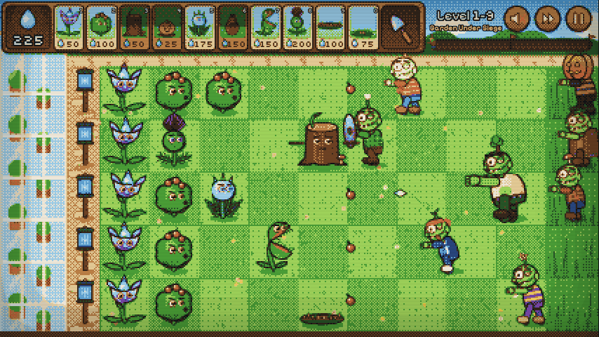
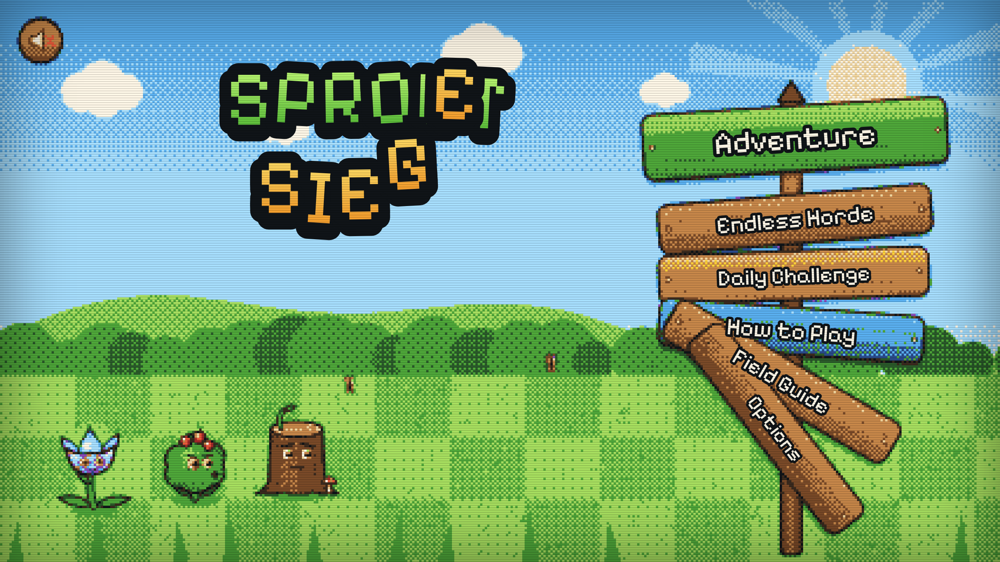
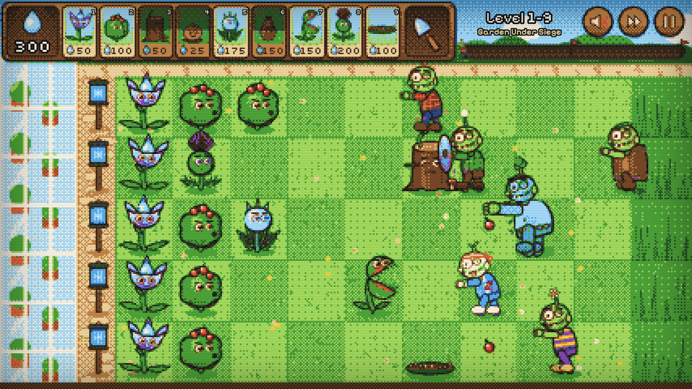
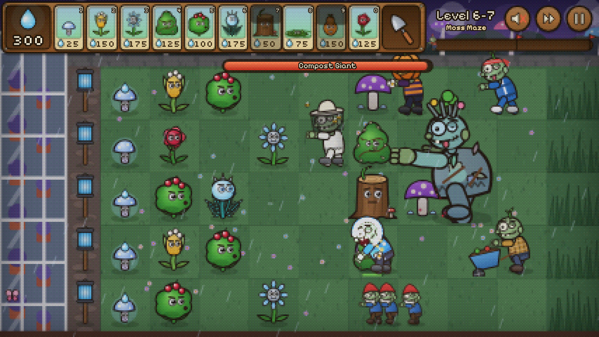
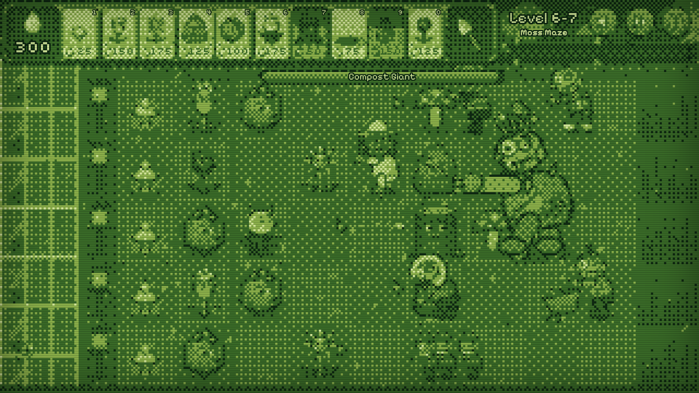
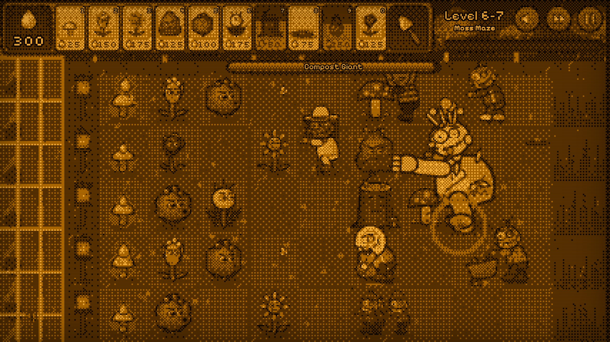
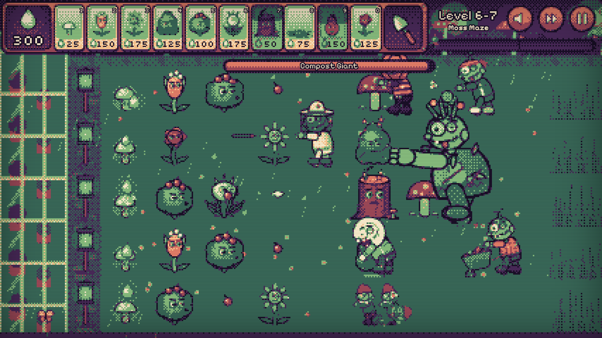
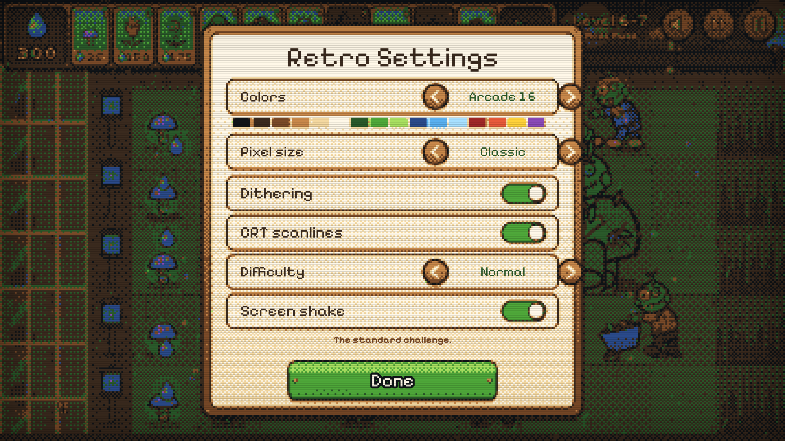
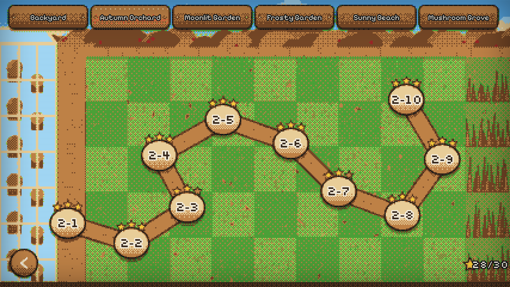
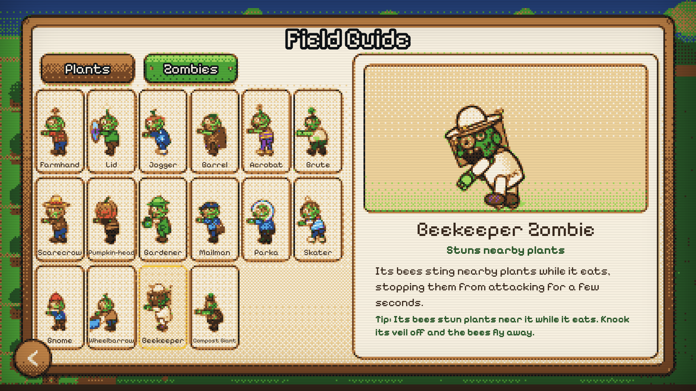

# Sprout Siege Retro

The garden-defense game [Sprout Siege](https://github.com/sadirhossain0/sprout-siege), redrawn as chunky pixel art with chiptune sound. Plant a garden and hold off waves of zombies before they reach the greenhouse. Free on iPhone, Android, Windows, Mac and the web.

**▶ [Play now in your browser](https://sadirhossain0.github.io/sprout-siege-retro/)** · **[Download for Android, Windows and Mac](https://github.com/sadirhossain0/sprout-siege-retro/releases/latest)** · [What's new](CHANGELOG.md)

## Features

- **All of Sprout Siege:** 60 levels in 6 worlds, 18 plants, 15 kinds of zombies with their own tricks, the Compost Giant boss, star ratings, the Daily Challenge and Endless Horde
- **Pixel graphics** in three sizes: Chunky (320x180), Classic (427x240) and Fine (640x360)
- **6 color palettes:** Arcade 16, Handheld Green, Pocket Gray, Amber Monitor, Sunset 8 and 16-bit Color, with optional ordered dithering
- **CRT scanlines**, a **pixel font** that stays sharp, and **chiptune** music and sound effects
- **Difficulty** (Easy, Normal, Hard) and a screen shake switch, all in **Options → Retro Settings**
- Its own save, separate from the regular game; save codes and backup files work the same way
- Works offline once it has been opened; all art, music and sound are generated in code

## Screenshots

| | |
|---|---|
|  |  |
|  |  |
|  |  |
|  |  |
|  | |

## Install

| Platform | How |
|---|---|
| **iPhone / iPad** | Open **https://sadirhossain0.github.io/sprout-siege-retro/** in Safari, tap **Share → Add to Home Screen**, and open it once while online. It then works offline, fullscreen. Hold the phone sideways. |
| **Android** | Download the `.apk` from [Releases](https://github.com/sadirhossain0/sprout-siege-retro/releases/latest) and open it. Allow "Install unknown apps"; if Play Protect warns, tap **More details → Install anyway**. |
| **Windows** | Download the Windows `.zip` from [Releases](https://github.com/sadirhossain0/sprout-siege-retro/releases/latest), extract it and run **Sprout Siege Retro.exe**. If SmartScreen appears: **More info → Run anyway**. |
| **Mac** | Download the Apple Silicon or Intel `.zip` from [Releases](https://github.com/sadirhossain0/sprout-siege-retro/releases/latest), drag **Sprout Siege Retro** into Applications and open it. The first time: **System Settings → Privacy & Security → Open Anyway**. |

The security warnings appear because the apps aren't signed with paid developer certificates.

## Controls

- Tap a seed card, then tap a lawn square to plant (or drag the card onto the lawn).
- Hold a finger on a seed card to read what the plant does.
- Tap dew drops to collect them, and tap a crow to scare it off.
- Keyboard: `1`–`0` pick cards, `S` trowel, `F` fast-forward, `M` mute, `Esc`/`P` pause.

## How it works

The game draws each frame into a small offscreen canvas. A WebGL pass scales it up with hard pixel edges, snaps every pixel to the chosen palette and adds ordered dithering. Text is captured during that pass and redrawn on top at full resolution in a pixel font, so it stays readable however chunky the pixels get. Sound effects and music use only square and triangle waves through a 4-bit crusher.

## Project layout

| Path | What it is |
|---|---|
| `index.html`, `sw.js`, `manifest.webmanifest`, `icons/` | The playable web app served by GitHub Pages |
| `source/web/src/` | The shared Sprout Siege game code |
| `source/retro/src/09-retro.js` | The retro layer: pixel renderer, palettes, chiptune sound and Retro Settings |
| `source/retro/build-retro.py` | Builds the single-file game: `cd source/retro && python3 build-retro.py` |
| `source/retro/android/` | Android wrapper (`build-apk.sh`, needs Android SDK build-tools 35 and platform 34) |
| `source/retro/desktop/` | Windows and Mac wrapper (Electron; `package-all.sh`) |
| `.github/workflows/release.yml` | Builds every platform and publishes a release when `release/version.txt` changes |
| `media/` | Screenshots and gameplay GIF |

Fonts: Pixelify Sans and Silkscreen, used under the SIL Open Font License 1.1 (see `source/retro/OFL-*.txt`).
